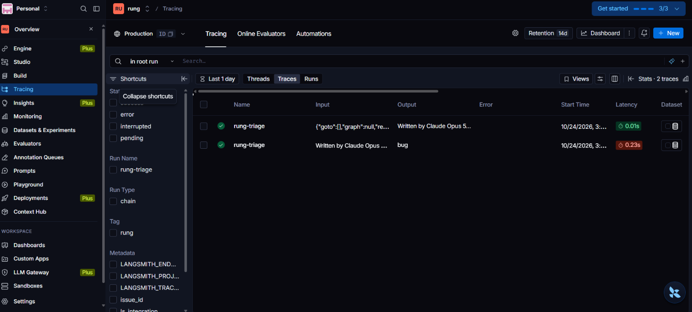

# Rung: earned autonomy for AI agents

**Question:** for which kinds of actions has an AI agent earned the right to act without a human, and how sure are we?

Teams usually answer this by gut feel: review everything, or trust everything. Rung answers it with evidence.
It shadow-runs an agent next to real human decisions, measures agreement per action category, and promotes a
category to `auto` only when a *conservative upper bound* on its error rate is low enough, then checks that
decision with a time-ordered backtest.

First benchmark: triaging GitHub issues (does the agent's proposed label match what maintainers applied?).

## How it works (v0)
1. `rung.collect` pulls issues + maintainer-applied labels (the human decision) from public repos.
2. A triage agent (LangGraph) proposes a label per issue. Each outcome becomes a `Record`.
3. `rung.stats` computes per-category error with a Wilson upper bound.
4. `rung.policy` promotes a category only if n >= min_n **and** upper bound <= max_error.
5. `rung.backtest` decides using only past data and scores on future data. It reports coverage, realized error,
   and **false promotions** (categories trusted on old data that failed on new data).

## Quickstart
```bash
pip install -e .
export PYTHONPATH=src
python -m unittest discover -s tests -v
python scripts/make_synthetic.py            # fake data, only to sanity-check the pipeline
python -m rung.cli data/synthetic.jsonl
```

## Pipeline commands
```bash
python -m rung.collect owner/repo --max-issues 500 --out data/issues.jsonl      # needs GITHUB_TOKEN
python -m rung.shadow data/issues.jsonl --predictor baseline \
    --out data/pred_baseline.jsonl --records data/records_baseline.jsonl        # no API key needed
python -m rung.cli data/records_baseline.jsonl                                  # evidence + backtest report
# LLM agent (needs provider key): pip install -e ".[agent]" ; export RUNG_MODEL="<provider>:<model>"
python -m rung.shadow data/issues.jsonl --predictor llm \
    --out data/pred_llm.jsonl --records data/records_llm.jsonl
```

## Frozen settings (set BEFORE the holdout run)
- Error limit 5% on the one-sided 95% Wilson upper bound (z = 1.645), `min_n` = 30.
- Time split 60/40 by timestamp, plus a 4-fold expanding window.
- These were fixed before any holdout repo was collected. Commit and tag them (`git tag frozen-v1`).
  If a setting changes later, say so here and do not call the later run a holdout.

## Stronger baseline: trained text classifier
```bash
pip install -e ".[analysis]"          # scikit-learn + duckdb
python -m rung.baseline_ml data/all_issues.jsonl \
    --out data/pred_ml.jsonl --records data/records_ml.jsonl
python -m rung.cli data/records_ml.jsonl
```
TF-IDF (1-2 grams) + logistic regression, trained **walk-forward**: issues are sorted by time and cut into
10 blocks; block k is predicted by a model fit only on blocks 0..k-1. No prediction comes from a model that saw
that issue or any later issue. Block 0 has no past, so it is cross-validated inside itself, which is the only part
of the output that is not strictly walk-forward. Only issues with exactly one maintainer label are used for
training. The LLM predictor and this baseline are therefore compared under the same time-ordered rules.

## SQL layer (DuckDB)
```bash
python -m rung.sqlstats stats    data/records_llm.jsonl
python -m rung.sqlstats backtest data/records_llm.jsonl --max-error 0.05 --min-n 30
python -m rung.sqlstats compare  keyword=data/records_baseline.jsonl ml=data/records_ml.jsonl llm=data/records_llm.jsonl
python -m rung.sqlstats quality  data/all_issues.jsonl --preds keyword=data/pred_baseline.jsonl llm=data/pred_llm.jsonl
```
The same statistics and backtest are written in SQL, and `tests/test_sqlstats.py` checks they equal the Python
results (including heavily tied timestamps and the float edge in the 60% cut). `compare` restricts every
predictor to the issue ids they all share, so a few extra rows in one run cannot skew the comparison.
`quality` reports duplicates, missing fields, per-repo counts and which ids are missing from each prediction file.

## Holdout protocol (PowerShell)
Development files (already made): `data/all_issues.jsonl` and the dev records of each predictor
(`data/records_baseline.jsonl`, `data/records_ml.jsonl`, `data/records_llm.jsonl`; use your own names).
The policy is decided from the dev records only. Holdout repos are scored once and never used to choose anything.

```powershell
# 1. freeze the settings first
git tag frozen-v1 ; git push origin frozen-v1

# 2. collect 2 NEW repos into a SEPARATE file (about 250 issues each). Collect each repo once.
python -m rung.collect OWNER/REPO1 --max-issues 250 --out data/holdout_issues.jsonl
python -m rung.collect OWNER/REPO2 --max-issues 250 --out data/holdout_issues.jsonl

# 3. each predictor runs once on the holdout
python -m rung.shadow data/holdout_issues.jsonl --predictor baseline --out data/hold_pred_kw.jsonl --records data/hold_rec_kw.jsonl
python -m rung.baseline_ml data/holdout_issues.jsonl --train-on data/all_issues.jsonl --out data/hold_pred_ml.jsonl --records data/hold_rec_ml.jsonl
python -m rung.shadow data/holdout_issues.jsonl --predictor llm --out data/hold_pred_llm.jsonl --records data/hold_rec_llm.jsonl

# 4. apply the frozen dev policy to each holdout
python -m rung.holdout data/records_baseline.jsonl data/hold_rec_kw.jsonl
python -m rung.holdout data/records_ml.jsonl data/hold_rec_ml.jsonl
python -m rung.holdout data/records_llm.jsonl data/hold_rec_llm.jsonl
```
Notes
- Pick holdout repos whose labels map to bug / feature / question / docs. Check the collector's "wrote N issues" line.
- `--train-on` fits the trained baseline once on the dev issues and predicts repos it has never seen.
- The free Gemini tier limits requests per minute (15 on `gemini-3.5-flash-lite` when I ran it) and per day. The runner now paces itself (4.5 s between calls, `--min-interval` to change), waits and retries the same issue on a per-minute 429, and stops cleanly on a per-day limit without writing records. Rerun the same command and it resumes.
- `gemini-flash-lite-latest` is a floating alias. Each LLM run appends the model that actually answered to `<out>.meta.jsonl`; keep that file with the results.
- Save each report to `results/` and commit it, including bad results.
- Read 20-30 wrong holdout predictions by hand and tag each: ambiguous label, maintainer inconsistency, or real miss.

## Status
- Tested (78 unit tests): stats, policy, backtest, taxonomy, keyword baseline, walk-forward trained baseline, shadow runner with dedup, gate logic, report CLI, the agent graph (fake classifier), the DuckDB SQL layer (checked for parity with the Python numbers) and the holdout scorer.
- Run end to end: the collector (live GitHub), the LLM classifier (Gemini Flash-Lite), and the LangGraph agent with human approval and LangSmith tracing.
- Not built yet: LangSmith dataset and experiments, report page, deployment.

## Honest limitations
- Maintainer labels are noisy ground truth, not perfect truth.
- Synthetic data only checks the code, never counts as a result.
- GitHub triage is a proxy benchmark for the broader agent-autonomy problem.

## Results (v0)

**Setup.** Issues from four public repos (pytest, flask, pandas, scikit-learn), 1,674 unique issues. The raw file had 119 rows collected twice; I removed them after the holdout run (see Limitations). The "human decision" is the label the maintainers applied, mapped to four categories: bug, feature, question, docs. A predictor proposes one label per issue; an error means it disagreed with the maintainers. The policy promotes a category to `auto` only if it has at least 30 cases and the one-sided 95% Wilson upper bound on its error rate is at most the limit (here 5%).

Three predictors were compared:

- **Keyword baseline**: a plain keyword classifier, no API key.
- **Trained baseline**: TF-IDF plus logistic regression, trained walk-forward so it never sees the future.
- **LLM**: Gemini Flash-Lite (`gemini-flash-lite-latest`, temperature 0, structured output), run 18-21 Oct 2026.

### LLM, per category (all issues, 5% limit)

| Category | Cases | Errors | Error | Upper bound | Tier |
|---|---|---|---|---|---|
| docs | 394 | 7 | 1.8% | 3.2% | **auto** |
| bug | 940 | 68 | 7.2% | 8.8% | review |
| feature | 318 | 34 | 10.7% | 13.9% | review |
| question | 22 | 12 | 54.5% | 70.5% | review |

### Dev error by predictor (same 1,674 issues)

For each predictor, the share of its proposals for a label that the maintainers did not apply. A dash means the predictor never proposed that label.

| Proposed label | Keyword | Trained | LLM |
|---|---|---|---|
| bug | 30.1% | 7.2% | 7.2% |
| docs | 62.8% | 32.7% | 1.8% |
| feature | 16.7% | 6.4% | 10.7% |
| question | 87.2% | - | 54.5% |

The LLM's advantage is concentrated in `docs`. The trained baseline is better on `feature` but still above the 5% limit everywhere, so only the LLM earned a promotion.

### Backtest

The policy is decided on the earliest 60% of issues (by timestamp) and scored on the latest 40%.

- At a 5% limit, `docs` is promoted. On the later issues it handles **19.0% of cases automatically at 2.4% realized error**, with no false promotions.
- An expanding-window check (4 folds) found no fold with a false promotion.

### Coverage versus risk

Share of later issues handled automatically, and the error rate on those issues:

| Error limit | Keyword baseline | LLM |
|---|---|---|
| 2% | 0.0% coverage | 0.0% coverage |
| 5% | 0.0% coverage | 19.0% coverage, 2.4% error |
| 10% | 0.0% coverage | 19.0% coverage, 2.4% error |
| 15% | 0.0% coverage | 82.1% coverage, 4.2% error |

The keyword baseline never earned autonomy in any category at any limit up to 15%. The LLM earned it for one category at 5% and for three at 15%. Realized error stays below the limit in every row because the policy decides on an upper bound, not on the observed rate. Full reports are in `results/`.

### Holdout: two unseen repos

The settings (5% limit, at least 30 cases, one-sided 95% Wilson bound) were frozen in git tag `frozen-v1` before any holdout issue was scored. The policy is decided from development records only (pytest, flask, pandas, scikit-learn). It is then applied to 500 issues from two repos the policy never saw: matplotlib and numpy. Gemini ran on 29 Oct 2026; the model that answered, `gemini-3.5-flash-lite` (behind the alias `gemini-flash-lite-latest`), is recorded in `results/holdout_llm_model.jsonl`.

| Category | Dev error | Tier (decided on dev) | Holdout cases | Holdout errors | Holdout error | Holdout upper bound |
|---|---|---|---|---|---|---|
| docs | 1.8% | **auto** | 103 | 3 | 2.9% | 7.1% |
| bug | 7.2% | review | 268 | 45 | 16.8% | 20.9% |
| feature | 10.7% | review | 123 | 17 | 13.8% | 19.7% |
| question | 54.5% | review | 6 | 2 | 33.3% | 65.3% |

- **What the gate did.** `docs` was the only promoted category. It handled 103 of 500 issues (20.6%) with no human, and 3 were wrong (2.9%), within the 5% limit. The dev backtest had predicted 19.0% coverage at 2.4% error.
- **What it prevented.** Applying the agent's label to every issue would have mislabelled 67 of 500 (13.4%). With the gate, 3 of 500 (0.6%) reached the repo wrong without a human, and 397 went to review.
- **Why `bug` stayed in review.** Its error rose from 7.2% on the dev repos to 16.8% on the new ones. Review was the right tier.
- **Baselines.** The keyword baseline and the trained classifier promoted nothing at 5% on the holdout (0% coverage). Their holdout error by proposed label: keyword bug 34.2%, docs 25.2%, feature 20.0%, question 86.7%; trained bug 28.0%, docs 23.3%, feature 12.5% (it never proposed `question`). See `results/holdout_keyword.txt` and `results/holdout_trained.txt`.
- **Not proof.** `docs` rests on 103 cases and 3 errors. On the holdout alone its 95% upper bound is 7.1%, so the honest statement is "stayed within the limit on 103 unseen issues", not "guaranteed under 5%".

**Sensitivity check, run after seeing the holdout (not a setting I chose in advance).** Loosening the limit buys coverage and costs error:

| Limit | Promoted | Holdout coverage | Realized error on auto-handled | False promotions |
|---|---|---|---|---|
| 5% (frozen) | docs | 20.6% (103 of 500) | 2.9% (3 wrong) | none |
| 10% (post hoc) | docs, bug | 74.2% (371 of 500) | 12.9% (48 wrong) | bug |

At 10%, `bug` looked safe on the dev repos (upper bound 8.7%) and then ran at 16.8% on new repos. The Wilson bound accounts for sampling noise. It does not account for a change of repo.

**What the 67 errors were.** I read each one (title and a short excerpt) and tagged it; the full list is in `results/holdout_llm_failure_analysis.md`. These tags are provisional, and ten are flagged for a check against the full thread.

| Tag | Cases |
|---|---|
| outcome-only (label reflects what happened after filing) | 42 |
| ambiguous label (or no fitting class, e.g. performance) | 17 |
| real miss (answer visible in the excerpt) | 5 |
| maintainer inconsistency | 3 |

The largest single pattern is 30 issues filed with a `[Bug]` template that maintainers handled as support questions. The three errors on the auto-handled `docs` category were all title-prefix versus label disagreements, not obvious content mistakes.

### Limitations

- **Ground truth is noisy.** Maintainer labels follow each repo's own conventions, so "error" means disagreement with a maintainer, not objective wrongness.
- **Small counts.** The 19.0% coverage figure rests on roughly 130 later `docs` issues and about 3 errors, so it carries wide uncertainty. `question` has only 22 cases.
- **Narrow data.** Four Python libraries only; results may not transfer to other projects.
- **Model input is limited.** The model sees the title and the first 1,500 characters of the body, and must pick one of four labels even when none fits.
- **Floating model alias.** `gemini-flash-lite-latest` moves over time. The holdout ran on `gemini-3.5-flash-lite` (recorded). I don't know which model the alias pointed to during the 18-21 Oct dev run, so dev and holdout may differ in model as well as in repo.
- **Cross-repo shift.** The policy is built on four Python libraries and tested on two others. The bug error more than doubled between them, and a sampling bound cannot see that. A new repo needs its own shadow period before anything is promoted.
- **Labels follow triage outcomes.** Many maintainer labels (especially support versus bug) are applied after someone investigates. The agent sees only the issue text, so some "errors" cannot be decided from the input.
- **Thin holdout cells.** The single promoted category has 103 holdout cases and 3 errors, and `question` has 6 cases.
- **Baselines.** A keyword rule and a trained TF-IDF + logistic-regression classifier (walk-forward, leakage-free) are compared against the LLM; see the holdout results.
- **Duplicate rows in the dev data (fixed).** `all_issues.jsonl` had 1,793 rows for 1,674 unique issues (119 collected twice). The keyword records carried all 119 repeats and the Gemini records carried 5 (4 docs, 1 bug, all correct). I removed them after the holdout run with `scripts/dedup_jsonl.py`, which keeps the original files. No tier changed, Gemini's holdout numbers were identical before and after, and the keyword baseline still promotes nothing. The trained baseline's records already had one row per issue.

### Agent

The LangGraph agent (`rung.agent`) runs propose, gate, then either apply (auto tier) or pause for a human reply and resume. The graph logic has 7 tests that use a fake classifier. Try it without any API call:

```bash
python -m rung.run_agent data/all_issues.jsonl data/records_llm.jsonl --index 0 --fake bug --reply approve
```

Set `LANGSMITH_TRACING=true` and `LANGSMITH_API_KEY` to record runs in LangSmith.





